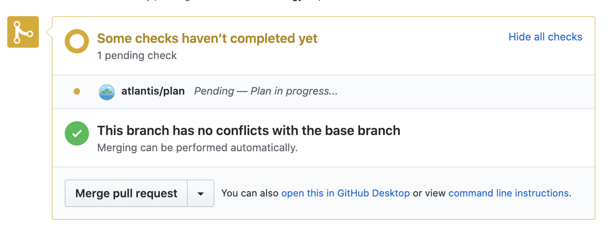
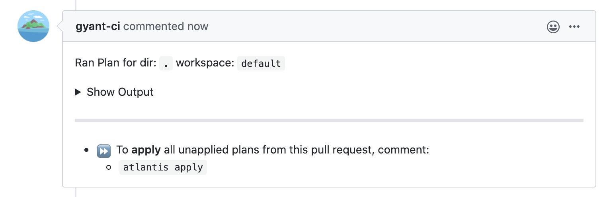
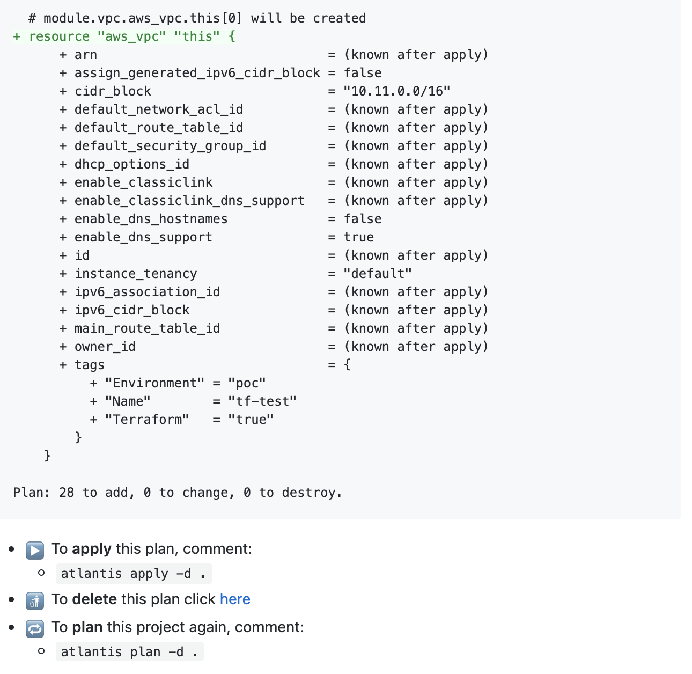
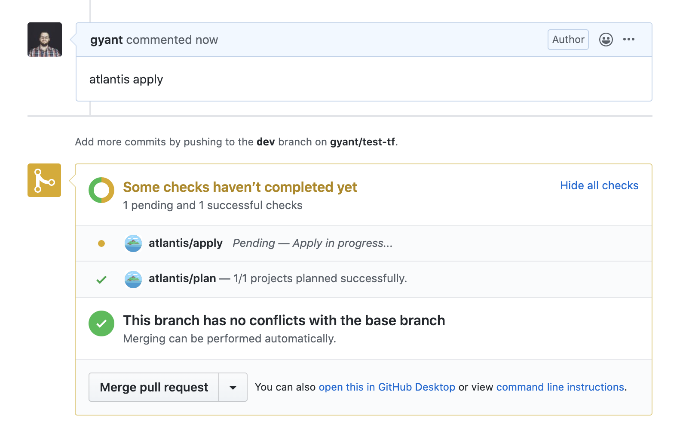
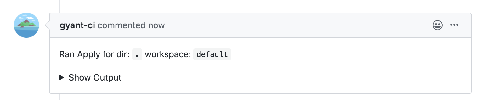
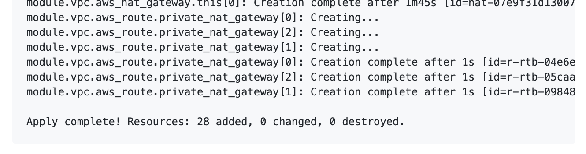
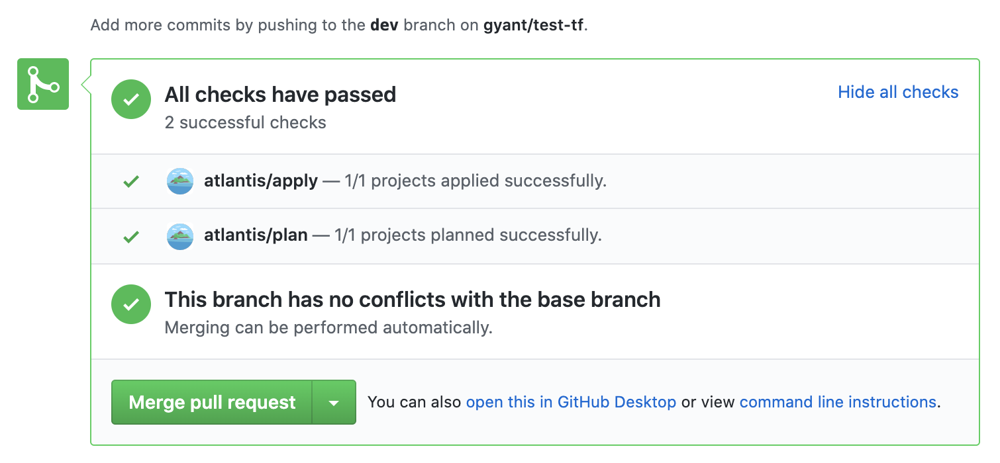
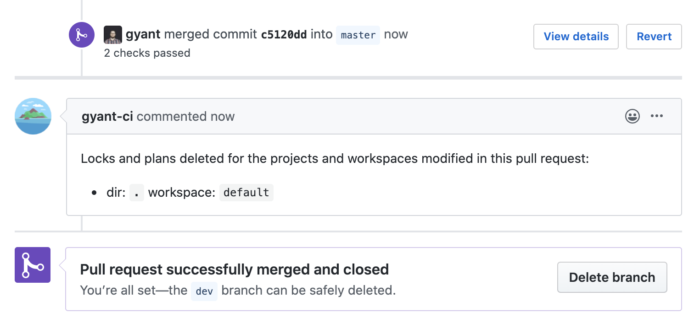
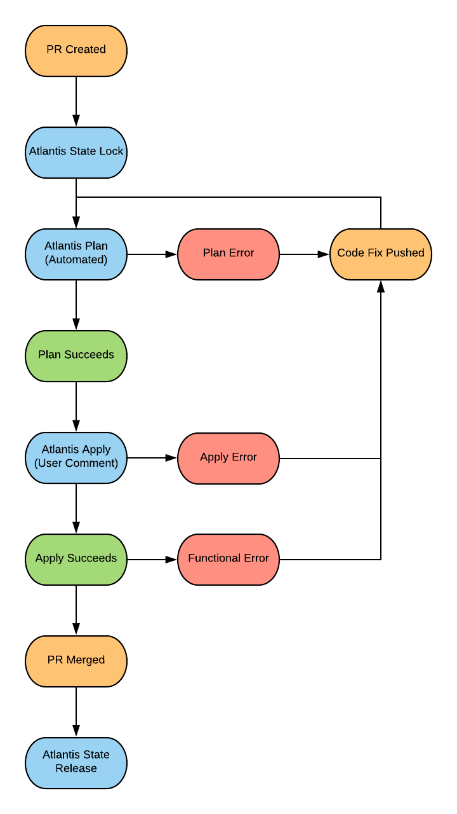

# Workflow

Atlantis works with a combination of automated triggers and manual user input mediated via git service providers. This document covers specifics for GitHub but other providers are supported.

Walking through a PR looks like this:

1. **Submit PR:**

    First and foremost, Atlantis will create a state lock for our terraform environment to prevent state changes from PRs submitted while our work is being done.

    Next, the status box will pick up the response from atlantis and indicate it is running a plan.

    

1. **Plan finishes:**

    Once the plan completes, we will see a new comment on the PR from the ci user.

    

    We can click `> Show Output` to get the details of the plan before we apply.

    

1. **Terraform Apply**

    Once we're ready to apply, simply comment `atlantis apply` to kick off the terraform apply. The status box at the bottom will reflect it is waiting for our apply to complete:

    

    When the apply finishes, we'll get an update from the ci user notifying us:

    

    As before we have a `> Show Output` function to get the details on the apply:

    

    After both the plan and apply completes, our status box reflects this state and idicates we're ready to merge:

    

1. **PR Merged**

    Atlantis has one last job to do once the PR is finally merged:

    

    The state lock is now released and other PRs can proceed with their changes after a rebase of the current upstream branch.

## What if something breaks?

Given the nature of terraform, we can expect things to not be perfect our first attempt. If anything goes wrong at any point in the process above, we are able to make amending commits to resolve our issue.

This includes:

1. Plan failed.
1. Apply failed.
1. Apply passed but had undesired results.

Atlantis will maintain its lock until the PR is closed or merged. So, we have time to either fix the problem or clean up our terraform state. Simply make the changes required, push up the commits, and the atlantis plan will trigger automatically and take us through the workflow anew.

***Generally this may look like a bunch of 'fix' commits. Before the final merge, it's a good idea to interactive rebase and roll these commits back up into their content commits and verify our atlantis plan has zero changes prior to merging.***

## Diagram

